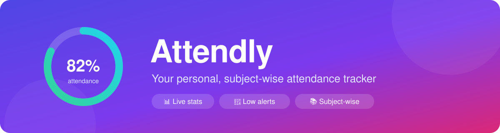
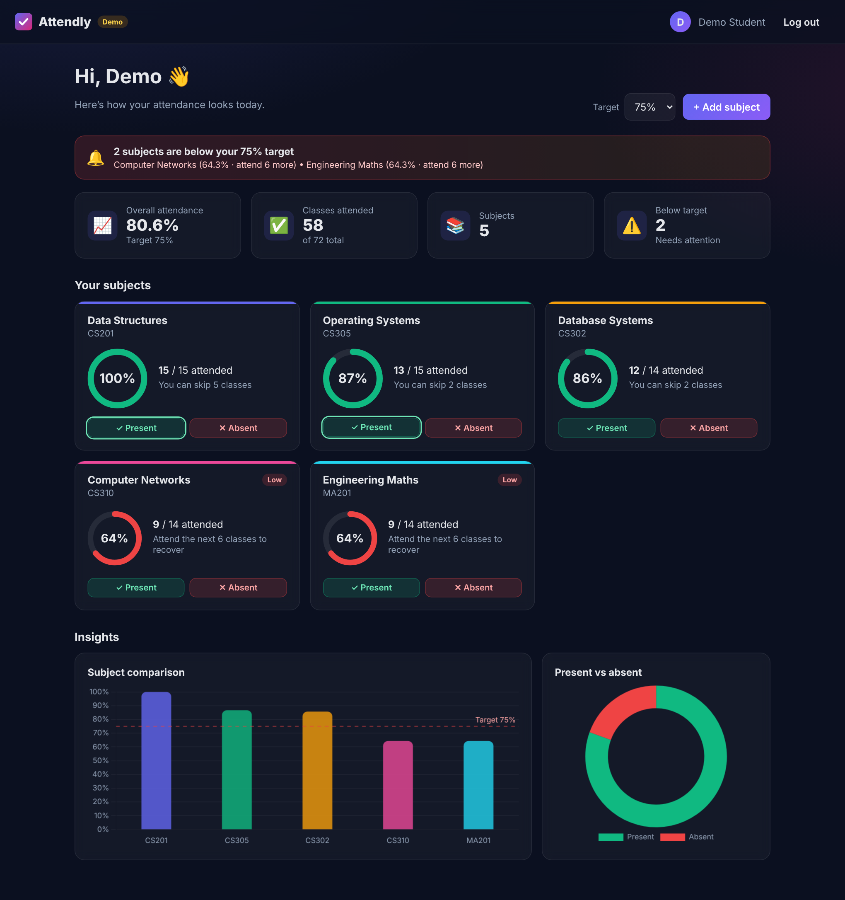
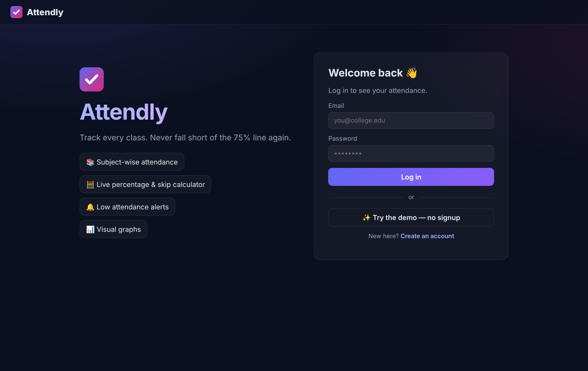
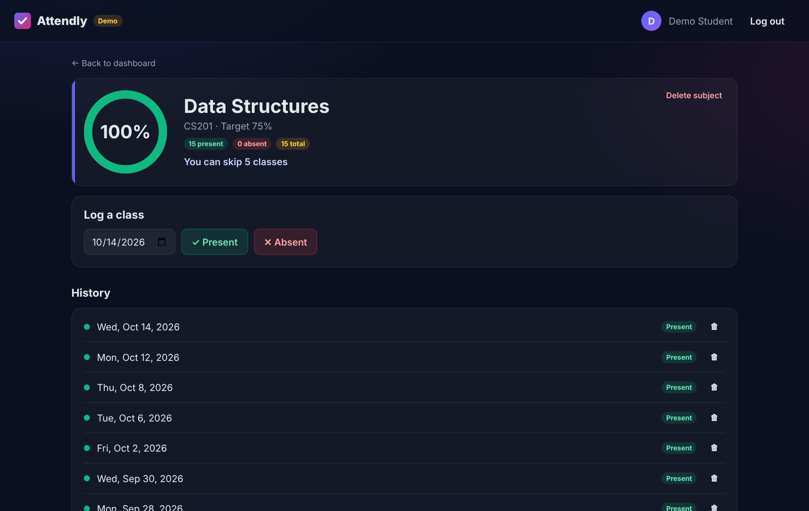
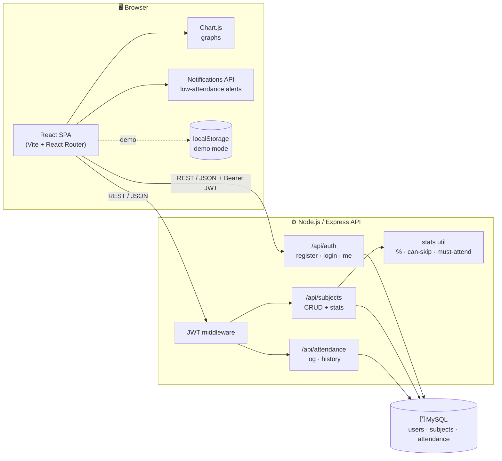
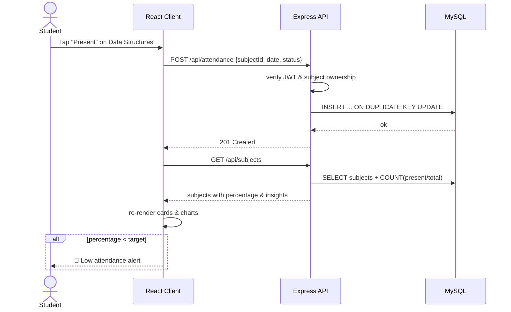
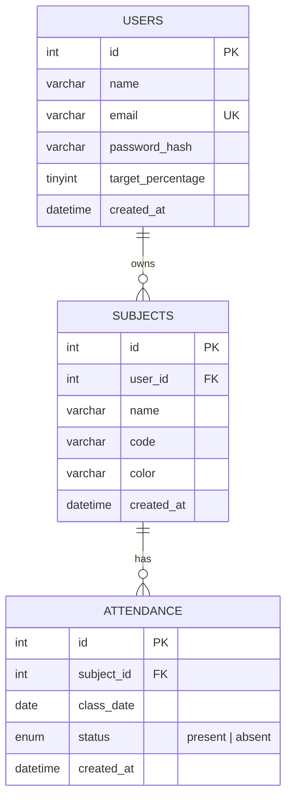

<p align="center">
  
</p>

<h1 align="center">Attendly — Student Attendance Tracker</h1>

<p align="center">
  <b>Track every class. Never fall short of the 75% line again.</b><br/>
  A simple, good-looking web app that helps students monitor subject-wise attendance, see their stats as charts, and get alerts before it's too late.
</p>

<p align="center">
  
  
  
  
  
  
</p>

<p align="center">
  
  
  
</p>

<p align="center">
  <a href="#-features">Features</a> •
  <a href="#-demo">Demo</a> •
  <a href="#-architecture">Architecture</a> •
  <a href="#-getting-started">Getting Started</a> •
  <a href="#-api-reference">API</a> •
  <a href="#-roadmap">Roadmap</a>
</p>

---

## 📖 About

Students often lose track of how many classes they've attended in each subject — and only find out about a shortage when it's too late.
**Attendly** fixes that with a personal dashboard:

1. **Register** and add the subjects you're taking.
2. **Log** each class as *Present* or *Absent* — one tap.
3. **See** your attendance percentage per subject and overall, with charts.
4. **Get alerted** when a subject drops below your target (default **75%**), along with how many classes you need to attend to recover.

> The project is intentionally simple: a React SPA talking to a small REST API backed by MySQL. No micro-services, no magic — easy to read, run and extend.

## ✨ Features

| | Feature | Description |
|---|---|---|
| 📚 | **Subject-wise tracking** | Add, colour-code, edit and delete your subjects. |
| ✅ | **One-tap logging** | Mark today (or any date) as Present / Absent. Re-marking a day updates it. |
| 🧮 | **Percentage calculator** | Live percentage per subject and overall. |
| 🎯 | **"Can I skip?" insights** | Shows how many classes you can safely miss — or must attend — to stay above target. |
| 🔔 | **Low attendance alerts** | In-app banner + browser push notification (Notifications API) when a subject falls below target. |
| 📊 | **Visual graphs** | Bar chart comparing subjects and a doughnut for overall present vs absent. |
| 🗓️ | **History** | Per-subject attendance log with quick delete. |
| 🔐 | **Auth** | Register / login with hashed passwords (bcrypt) and JWT sessions. |
| 🧪 | **Demo mode** | Try the full UI in the browser with no backend — data lives in `localStorage`. |
| 🌙 | **Modern UI** | Clean dark theme, responsive layout, works on phones. |

## 🎬 Demo

<p align="center">
  
  <br/><sub><b>Dashboard</b> — overall stats, alerts, per-subject cards and charts</sub>
</p>

<table>
  <tr>
    <td align="center" width="50%">
      
      <br/><sub><b>Login</b> — or jump straight in with demo mode</sub>
    </td>
    <td align="center" width="50%">
      
      <br/><sub><b>Subject detail</b> — log classes &amp; browse history</sub>
    </td>
  </tr>
</table>

> 💡 **Try it locally in 30 seconds:** run the client only (`cd client && npm i && npm run dev`) and press **“Try the demo”** on the login screen.

## 🏗️ Architecture



### Request flow — logging a class



### Data model



### Project structure

```text
Attendly/
├── client/                 # React + Vite frontend
│   ├── src/
│   │   ├── api/            # REST client + localStorage demo adapter
│   │   ├── components/     # Navbar, SubjectCard, ProgressRing, charts, modals…
│   │   ├── context/        # AuthContext (JWT session)
│   │   ├── hooks/          # useLowAttendanceAlerts (Notifications API)
│   │   ├── pages/          # Login, Register, Dashboard, SubjectDetail
│   │   └── utils/          # attendance math shared by UI & demo mode
│   └── vite.config.js      # dev proxy /api → :5000
├── server/                 # Node.js + Express REST API
│   ├── db/schema.sql       # MySQL schema
│   ├── src/
│   │   ├── routes/         # auth, subjects, attendance
│   │   ├── middleware/     # JWT auth, error handler
│   │   └── utils/stats.js  # percentage / can-skip / must-attend
│   └── test/               # node:test unit tests
├── docs/                   # banner & screenshots
└── .github/workflows/      # CI: test server, build client
```

## 🧰 Tech Stack

| Layer | Technology |
|---|---|
| **Frontend** | React 18, Vite, React Router, Chart.js (`react-chartjs-2`), plain CSS |
| **Backend** | Node.js, Express, `jsonwebtoken`, `bcryptjs`, `mysql2` |
| **Database** | MySQL 8 |
| **Notifications** | Web Notifications API (browser push-style alerts) |
| **Tooling** | GitHub Actions CI, `node:test` |

## 🚀 Getting Started

### Prerequisites

- [Node.js](https://nodejs.org/) **20+** and npm
- [MySQL](https://dev.mysql.com/downloads/) **8+** (not needed for demo mode)
- Git

### 1. Clone

```bash
git clone https://github.com/nagabhavit/Attendly_-Attendance_Management_project-.git attendly
cd attendly
```

### 2. Database

```bash
mysql -u root -p < server/db/schema.sql
```

### 3. Backend

```bash
cd server
cp .env.example .env      # then fill in your MySQL credentials & a JWT secret
npm install
npm run dev               # API on http://localhost:5000
```

### 4. Frontend

```bash
cd client
npm install
npm run dev               # App on http://localhost:5173 (proxies /api → :5000)
```

### Environment variables (`server/.env`)

| Variable | Default | Description |
|---|---|---|
| `PORT` | `5000` | API port |
| `DB_HOST` | `localhost` | MySQL host |
| `DB_PORT` | `3306` | MySQL port |
| `DB_USER` | `root` | MySQL user |
| `DB_PASSWORD` | — | MySQL password |
| `DB_NAME` | `attendly` | Database name |
| `JWT_SECRET` | — | Secret used to sign tokens (**required**) |
| `CLIENT_ORIGIN` | `http://localhost:5173` | Allowed CORS origin |

## 📡 API Reference

All routes except `register`/`login` need `Authorization: Bearer <token>`.

| Method | Endpoint | Body | Description |
|---|---|---|---|
| `POST` | `/api/auth/register` | `{ name, email, password }` | Create account, returns `{ token, user }` |
| `POST` | `/api/auth/login` | `{ email, password }` | Log in, returns `{ token, user }` |
| `GET` | `/api/auth/me` | — | Current user |
| `PATCH` | `/api/auth/me` | `{ targetPercentage }` | Update attendance target |
| `GET` | `/api/subjects` | — | Subjects with `present`, `total`, `percentage`, `canSkip`, `mustAttend` |
| `POST` | `/api/subjects` | `{ name, code?, color? }` | Add subject |
| `PUT` | `/api/subjects/:id` | `{ name, code?, color? }` | Update subject |
| `DELETE` | `/api/subjects/:id` | — | Delete subject (and its records) |
| `GET` | `/api/attendance?subjectId=` | — | Attendance history |
| `POST` | `/api/attendance` | `{ subjectId, date, status }` | Log / update a class |
| `DELETE` | `/api/attendance/:id` | — | Remove a record |

## 🧮 How the maths works

With `P` classes attended out of `T` and a target ratio `r` (e.g. `0.75`):

- **Percentage** = `P / T × 100`
- **Must attend** (to get back to target) = `⌈(r·T − P) / (1 − r)⌉`
- **Can skip** (and still stay on target) = `⌊P / r − T⌋`

## 🗺️ Roadmap

- [x] Subject-wise attendance tracking
- [x] Percentage calculator & skip/attend insights
- [x] Low attendance alerts (in-app + browser notifications)
- [x] Charts & visual summaries
- [x] Demo mode without backend
- [ ] Weekly timetable → auto reminders before each class
- [ ] Export attendance as CSV / PDF
- [ ] PWA install & offline sync
- [ ] Light theme toggle

## 🤝 Contributing

Contributions, issues and feature requests are welcome! See [CONTRIBUTING.md](CONTRIBUTING.md).

1. Fork the repo
2. Create a branch: `git checkout -b feat/amazing-feature`
3. Commit using [Conventional Commits](https://www.conventionalcommits.org/): `git commit -m "feat: add amazing feature"`
4. Push and open a Pull Request

## 👤 Creator

<table>
  <tr>
    <td align="center">
      <a href="https://github.com/nagabhavit">
        <br />
        <sub><b>nagabhavit</b></sub>
      </a><br/>
      <sub>Creator &amp; Maintainer</sub>
    </td>
  </tr>
</table>

- GitHub: [@nagabhavit](https://github.com/nagabhavit)

## 🙏 Acknowledgments

- Inspired by open-source attendance management systems such as [aliatayee/Attendance_Management_System](https://github.com/aliatayee/Attendance_Management_System)
- Badges by [shields.io](https://shields.io), charts by [Chart.js](https://www.chartjs.org/)

## 📄 License

Distributed under the MIT License. See [`LICENSE`](LICENSE) for details.

<p align="center">⭐ If Attendly helped you stay above 75%, give it a star!</p>
